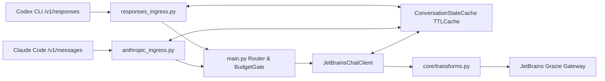

# Requirements

### Overview & Goals

Extend `ai-model-interop` so that:
1. **Codex CLI** (which speaks the OpenAI Responses API via `POST /v1/responses`) can seamlessly use **Anthropic Claude** (as well as Gemini, Grok, and GPT) routed through the **JetBrains Grazie Gateway** with **1:1 native OpenAI API behavior**.
2. **Claude Code** (which speaks the Anthropic Messages API via `POST /v1/messages`) can reliably use **GPT, Gemini, Grok, and Claude** routed through the **JetBrains Grazie Gateway** across multi-turn tool-calling sessions.

---

### Scope

#### In Scope
- **Unified OpenAI Responses API Ingress/Egress (`POST /v1/responses`)**:
  - Full request parsing (`instructions`, string/array `input`, `developer`/`user`/`assistant` messages, `function_call`, `function_call_output`, `custom_tool_call`, `custom_tool_call_output`, `reasoning` history items, flat `tools`, `tool_choice`, `parallel_tool_calls`, `reasoning`, `previous_response_id`, and tolerated metadata fields like `store`, `include`, `prompt_cache_key`, `truncation`).
  - Automatic wrapping and unwrapping of Codex freeform **Custom Tools** (`type: "custom"`, e.g., `apply_patch`) so non-OpenAI models (Claude, Gemini) can invoke them via standard JSON tool calls while Codex receives native `custom_tool_call` items.
  - Full Responses JSON output and SSE event stream (`event: <type>\ndata: <json>\n\n`) matching native OpenAI Responses API specifications.
- **1:1 Parameter Translation Across Frontier Providers**:
  - Standard reasoning effort levels (`low`, `medium`, `high`, `xhigh`, `max`) translated to each target protocol's native mechanism (`reasoning.effort` for OpenAI/xAI, `thinking.budget_tokens` for Anthropic Claude, `thinkingConfig` for Google Gemini).
  - Non-standard, provider-exclusive effort levels that cannot be mapped across tools/providers (e.g., `ultracode`) explicitly rejected with HTTP 400.
  - `parallel_tool_calls` mapped to `disable_parallel_tool_use` on Anthropic and tolerated on Gemini without false HTTP 400 errors.
- **Bounded In-Memory Multi-Turn State Cache (RAM Only)**:
  - Automatic restoration of prior conversation turns when Codex sends `previous_response_id`.
  - Automatic preservation and restoration of Gemini `thoughtSignature` across multi-turn tool calls initiated from stateless clients (Claude Code or Codex).
  - Bounded memory usage via TTL + LRU eviction (`cachetools.TTLCache`) with zero disk or SQLite bloat.
- **JetBrains Provider Stabilization & Routing Enhancements**:
  - Automatic protocol inference from model names (`claude*`, `gemini*`, `grok*`, `gpt*`/`o1*`/`o3*`/`o4*`) for dynamic `jetbrains:<model>` calls and registry entries.
  - Configurable Grazie authentication header modes (`Authorization: Bearer` for Workspace vs `Grazie-Authenticate-JWT` for Personal licenses) and customizable `Grazie-Agent`.
  - Fix consecutive turn merging (`_append_anthropic_turn`) and `is_error` propagation in `JetBrainsChatClient._build_anthropic_request_body()`.

#### Out of Scope
- Adding external translation frameworks such as `litellm` SDK or running a separate proxy process.
- Persisting conversation transcripts to SQLite or external databases.
- Modifying the Codex CLI or Claude Code client binaries.

---

### User Stories

- **As a Codex CLI user**, I want to configure my model provider to point to `ai-model-interop` (`POST /v1/responses`) and use a JetBrains-backed Claude model so that code analysis, shell execution, `apply_patch` edits, reasoning effort settings, and multi-turn tool calls work identically to native OpenAI models.
- **As a Claude Code user**, I want to point `ANTHROPIC_BASE_URL` to `ai-model-interop` (`POST /v1/messages`) and select JetBrains-backed GPT, Gemini, or Grok aliases so that multi-turn tool execution and thinking modes work without HTTP 400 parameter errors or missing Gemini signature failures.
- **As a bridge operator**, I want dynamic `jetbrains:<model>` routing, configurable Grazie auth headers, and bounded RAM caching so that I can switch models and account types via environment variables without disk growth or manual registry boilerplate.

---

### Functional Requirements

1. **Native OpenAI Responses API (`POST /v1/responses`)**:
   - Accept top-level `instructions` and merge with leading `developer`/`system` messages.
   - Convert mid-conversation `role: "developer"` items into user/system instructions preserved in turn order.
   - Normalize flat function tools (`{"type": "function", "name": ..., "parameters": ...}`) into internal nested function tool format.
   - Wrap custom tools (`{"type": "custom", "name": "apply_patch", ...}`) into JSON function tools with a single `input: string` property for upstream models, and convert resulting tool calls back into `type: "custom_tool_call"` (and `type: "custom_tool_call_output"` inputs back into `role: "tool"` messages).
   - Skip incoming `type: "reasoning"` input items (`encrypted_content`, `summary`) cleanly without raising errors.
   - Emit complete SSE event sequences (`response.created` -> `response.in_progress` -> `response.output_item.added` -> content/argument deltas -> `response.output_item.done` -> `response.completed`) with `event:` headers.
2. **Reasoning & Tool Control Parity**:
   - Accept standard reasoning effort values `{"low", "medium", "high", "xhigh", "max"}` from `/v1/responses` (`reasoning.effort`), `/v1/chat/completions` (`reasoning_effort`), and `/v1/messages` (`output_config.effort`).
   - Reject unknown/unmappable effort values (e.g., `ultracode`) with HTTP 400.
   - Translate standard effort values into provider-specific configurations (`openai_responses`, `xai_responses`, `anthropic_messages`, `google_generate_content`).
   - Translate `parallel_tool_calls=False` into `tool_choice: {"type": ..., "disable_parallel_tool_use": True}` for Anthropic; ignore for Google Gemini.
3. **Bounded RAM State Restoration**:
   - Store completed `/v1/responses` turn history in a `TTLCache` under `response.id` and prepend prior messages when a subsequent request specifies `previous_response_id` (returning HTTP 400 if an unknown/expired `previous_response_id` is explicitly requested and no full history is present).
   - Cache Gemini `_google_call_parts` (`thoughtSignature`) by `tool_call_id` in `TTLCache` and re-inject them when building the next turn's `model` `functionCall` parts.
4. **JetBrains Provider Routing & Auth**:
   - Infer protocol automatically when omitted: `claude*` -> `anthropic_messages`, `gemini*` -> `google_generate_content`, `grok*` -> `xai_responses`, otherwise `openai_responses`.
   - Support `JETBRAINS_AI_AUTH_MODE=bearer|jwt` (or header override) and `JETBRAINS_GRAZIE_AGENT`.

# Technical Design

### Current Implementation

- **Ingress Layer**:
  - `openai_compatible_bridge/main.py` exposes `POST /v1/chat/completions` and `POST /v1/messages`.
  - `openai_compatible_bridge/anthropic_ingress.py` implements Anthropic request parsing (`parse_anthropic_chat_params`), non-streaming response formatting (`openai_result_to_anthropic`), and streaming SSE state machine (`AnthropicStreamState`) in a single cohesive module.
- **Provider & Transformation Layer**:
  - `openai_compatible_bridge/core/transforms.py` contains shared converters (`_openai_input_messages`, `_xai_input_messages`, `_append_anthropic_turn`, `_google_contents_and_system`, `_google_response_result`, etc.).
  - `openai_compatible_bridge/providers/jetbrains.py` implements `JetBrainsChatClient` for Grazie Gateway across 4 protocols (`openai_responses`, `anthropic_messages`, `xai_responses`, `google_generate_content`).
- **Identified Gaps & Bugs in Existing Code**:
  1. `JetBrainsChatClient._build_anthropic_request_body()` imports `_append_anthropic_turn` but appends directly to `chat_messages`, causing consecutive `user` role HTTP 400 errors on multi-item inputs and dropping `is_error` on tool results.
  2. `validate_jetbrains_parameters()` and `main.py` reject `reasoning_effort` and `parallel_tool_calls` with HTTP 400 on JetBrains routes, and `_build_openai_request_body()` omits `reasoning` forwarding.
  3. Flat tool definitions from `/v1/responses` (`{"type": "function", "name": ...}`) lose their `name` and `parameters` because `_build_anthropic_request_body()` checks `t.get("function", {}) if t.get("type") == "function"`.
  4. `JetBrainsChatClient.map_http_error()` passes `"openai_compatible"` instead of `"jetbrains"`, `pricing_fallbacks()` lacks `("jetbrains:*",)`, and default `lifespan()` in `main.py` misses `jetbrains_chat_client.close()`.

---

### Key Decisions

1. **Extend Native Lightweight Converter Instead of Adding `litellm` SDK**:
   - **Decision**: Build on the existing `core/transforms.py` and ingress architecture without adding `litellm`.
   - **Rationale**: 85% of the provider transformation and cost-accounting pipeline already exists in pure Python (`FastAPI` + `httpx` + `cachetools`). Avoiding `litellm` prevents heavy dependency bloat, dual transformation paths, and conflicts with Grazie Gateway's custom endpoints and headers.
2. **Unified `responses_ingress.py` Module**:
   - **Decision**: Co-locate `/v1/responses` request parsing, non-streaming response conversion, and `ResponsesStreamState` SSE framing in `openai_compatible_bridge/responses_ingress.py`.
   - **Rationale**: Mirrors `openai_compatible_bridge/anthropic_ingress.py` 1:1, keeping route handlers in `main.py` thin and consistent.
3. **1:1 Native OpenAI API Behavior Including Custom Tools (`apply_patch`)**:
   - **Decision**: Normalize both `type: "function"` and `type: "custom"` tools into the internal tool format, tagging custom tool names so egress reconstructs `custom_tool_call` items and SSE events (`response.custom_tool_call_input.delta` / `done`).
   - **Rationale**: Guarantees Codex CLI works out-of-the-box with Claude/Gemini without requiring users to disable native Codex tools.
4. **Standard Reasoning Effort Mapping + Strict Rejection of Unmappable Values**:
   - **Decision**: Map standard levels (`low`, `medium`, `high`, `xhigh`, `max`) to each provider's native thinking/reasoning config, and reject non-standard provider-exclusive values (such as `ultracode`) with HTTP 400.
   - **Rationale**: Preserves user intent across frontier models while failing fast on unsupported proprietary levels.
5. **Bounded In-Memory Cache (`cachetools.TTLCache`) for Multi-Turn State**:
   - **Decision**: Use an in-memory `TTLCache` (default 512 entries, 3600s TTL) to store `response_id` conversation history and `tool_call_id` Gemini `thoughtSignature` parts.
   - **Rationale**: Bridges the stateless gap for `previous_response_id` and Gemini multi-turn tool calls without SQLite disk growth or manual DB flushing.

---

### Architecture Diagram



---

### Data Models / Contracts

#### 1. Reasoning Effort Mapping Contract (`core/transforms.py` & `providers/jetbrains.py`)

```python
STANDARD_REASONING_EFFORTS = {"low", "medium", "high", "xhigh", "max"}

ANTHROPIC_THINKING_BUDGETS = {
    "low": 1024,
    "medium": 4096,
    "high": 16384,
    "xhigh": 32768,
    "max": 32768,
}

GOOGLE_THINKING_BUDGETS = {
    "low": 1024,
    "medium": 4096,
    "high": 16384,
    "xhigh": 24576,
    "max": 24576,
}
```
- For `anthropic_messages`: when `reasoning_effort` is in `STANDARD_REASONING_EFFORTS`, set `body["thinking"] = {"type": "enabled", "budget_tokens": budget}` and ensure `max_tokens > budget` (auto-adjusting `max_tokens = max(max_tokens or 0, budget + 4096)`), and omit `temperature`/`top_p` if required by Anthropic thinking constraints.
- For `openai_responses`: set `body["reasoning"] = {"effort": "high" if reasoning_effort == "max" else reasoning_effort}`.
- For `xai_responses`: clamp via `_clamp_xai_reasoning_effort(reasoning_effort)` and set `body["reasoning"] = {"effort": clamped}`.
- For `google_generate_content`: set `generationConfig["thinkingConfig"] = {"thinkingBudget": GOOGLE_THINKING_BUDGETS[reasoning_effort]}`.

#### 2. Bounded Conversation State Cache (`openai_compatible_bridge/core/conversation_state.py`)

```python
class ConversationStateCache:
    def __init__(self, *, maxsize: int = 512, ttl_seconds: int = 3600) -> None: ...
    def save_response(
        self,
        response_id: str,
        *,
        messages: list[dict[str, Any]],
        custom_tool_names: set[str],
    ) -> None: ...
    def get_response(self, response_id: str) -> dict[str, Any] | None: ...
    def save_google_call_part(self, tool_call_id: str, part: dict[str, Any]) -> None: ...
    def get_google_call_part(self, tool_call_id: str) -> dict[str, Any] | None: ...
```

#### 3. Unified Responses Ingress/Egress (`openai_compatible_bridge/responses_ingress.py`)

```python
class ResponsesBadRequest(Exception):
    def __init__(self, message: str, *, param: str | None = None, code: str = "invalid_request_error") -> None: ...

def parse_responses_chat_params(
    payload: Any,
    *,
    state_cache: ConversationStateCache | None = None,
) -> dict[str, Any]:
    """Validate POST /v1/responses payload and normalize into internal chat params:
    {
        "model", "messages", "max_tokens", "temperature", "top_p",
        "reasoning_effort", "stop", "stream", "tools", "tool_choice",
        "parallel_tool_calls", "response_format", "custom_tool_names",
        "previous_response_id"
    }
    """

def openai_result_to_responses(
    result: dict[str, Any],
    *,
    model: str,
    response_id: str,
    custom_tool_names: set[str] | None = None,
) -> dict[str, Any]:
    """Convert internal {text, tool_calls, finish_reason, usage} into an OpenAI Responses object."""

class ResponsesStreamState:
    """State machine converting internal stream events {"delta_text", "delta_tool_calls", "finish_reason", "usage"}
    into OpenAI Responses SSE strings (`event: <type>\\ndata: <json>\\n\\n`)."""
    def __init__(
        self,
        *,
        response_id: str,
        model: str,
        custom_tool_names: set[str] | None = None,
    ) -> None: ...
    def on_event(self, event: dict[str, Any]) -> list[str]: ...
    def finalize(self) -> list[str]: ...
```

---

### File Structure

- **Added**:
  - `openai_compatible_bridge/core/conversation_state.py` — Bounded `TTLCache` store for `previous_response_id` context and Gemini `thoughtSignature` parts.
  - `openai_compatible_bridge/responses_ingress.py` — Unified OpenAI Responses API ingress parser, custom tool wrapper/unwrapper, non-streaming response builder, and SSE state machine.
  - `tests/test_responses_ingress.py` — Unit tests for `/v1/responses` parsing, custom tool conversion, and SSE event sequences.
  - `tests/test_responses_route.py` — End-to-end FastAPI route tests for `POST /v1/responses` (Codex -> Claude / Gemini / GPT flows).
- **Modified**:
  - `openai_compatible_bridge/providers/jetbrains.py` — Fix `_build_anthropic_request_body()` turn merging & `is_error`, add protocol auto-inference by model name, support configurable Grazie auth headers, map `reasoning_effort` & `parallel_tool_calls` across all 4 protocols, and restore cached Gemini `thoughtSignature` parts.
  - `openai_compatible_bridge/core/transforms.py` — Add shared reasoning budget/effort helpers, custom tool input extraction, and Gemini `_google_call_parts` fallback restoration from `ConversationStateCache`.
  - `openai_compatible_bridge/core/provider_adapter.py` — Add `("jetbrains:*",)` to `pricing_fallbacks()`.
  - `openai_compatible_bridge/main.py` — Add `POST /v1/responses` route, initialize `app.state.conversation_state`, relax JetBrains parameter gate to use protocol-aware validation, and close `jetbrains_chat_client` on shutdown.
  - `tests/test_jetbrains_chat.py` & `tests/test_anthropic_messages.py` — Update existing parameter rejection tests and add coverage for new mappings and multi-turn flows.

---

### Risks & Mitigations

- **Anthropic Thinking Constraints (`max_tokens` & `temperature`)**:
  - *Risk*: Anthropic API returns HTTP 400 if `thinking.budget_tokens >= max_tokens` or if `temperature` is set to a value other than `1` when thinking is enabled.
  - *Mitigation*: When mapping `reasoning_effort` to Anthropic `thinking`, automatically ensure `max_tokens > budget_tokens` (defaulting or bumping `max_tokens`) and strip `temperature`/`top_p` from the upstream Anthropic request.
- **Custom Tool (`apply_patch`) Argument Decoding**:
  - *Risk*: When `apply_patch` is wrapped as a JSON function tool (`{"input": "..."}`), the model emits a JSON string containing the patch, whereas Codex expects raw patch text in `custom_tool_call.input`.
  - *Mitigation*: In `openai_result_to_responses()` and `ResponsesStreamState`, when a tool name is in `custom_tool_names`, parse the JSON arguments object and extract the `"input"` string field (falling back to raw arguments if already a plain string) before emitting `custom_tool_call`.

# Testing

### Validation Approach

All changes will be validated through automated `pytest` unit and integration suites simulating real Codex CLI (`POST /v1/responses`) and Claude Code (`POST /v1/messages`) payloads against mocked JetBrains Grazie upstream endpoints (Anthropic, OpenAI, Google, xAI).

---

### Key Scenarios

1. **Codex -> Claude (`POST /v1/responses` -> `jetbrains` / `anthropic_messages`)**:
   - Single-turn text generation (non-streaming and SSE streaming) verifying exact event ordering (`response.created` through `response.completed`).
   - Multi-turn `function_call` (`shell` / `exec_command`) and `function_call_output` round-trip preserving `call_id` and merging consecutive `developer`/`user`/`tool` items without Anthropic role alternation errors.
   - Freeform Custom Tool (`type: "custom"`, `name: "apply_patch"`) wrapped into an Anthropic `tools` definition, invoked by Claude as `tool_use`, and returned to Codex as `type: "custom_tool_call"` followed by `type: "custom_tool_call_output"` in the next turn.
   - Stateful continuation using `previous_response_id` restoring prior messages from `ConversationStateCache`.
2. **Claude Code -> GPT / Gemini / Grok (`POST /v1/messages` -> `jetbrains`)**:
   - Dynamic model routing (`jetbrains:claude-sonnet-4-5`, `jetbrains:gemini-2.5-pro`, `jetbrains:grok-3`, `jetbrains:gpt-4.1`) auto-inferring the target protocol without explicit `MODEL_REGISTRY_JSON` entries.
   - Multi-turn Gemini tool calling where `thoughtSignature` is cached on turn 1 and automatically re-attached to the model's `functionCall` part on turn 2.
   - `output_config.effort` (`low`, `medium`, `high`, `xhigh`, `max`) translated to upstream reasoning/thinking configs without HTTP 400 errors.

---

### Edge Cases

- **Unmappable Reasoning Effort**: Sending `reasoning.effort = "ultracode"` (or any value outside `{"low", "medium", "high", "xhigh", "max"}`) returns HTTP 400 `invalid_request_error`.
- **Anthropic Thinking + Small `max_tokens` / Non-1.0 `temperature`**: Sending `reasoning.effort = "high"` with `max_tokens = 1024` and `temperature = 0.2` automatically adjusts `max_tokens` above `budget_tokens` and omits `temperature` for the upstream Anthropic call.
- **`parallel_tool_calls=False` on Anthropic & Gemini**: Maps to `tool_choice.disable_parallel_tool_use = True` on Anthropic when tools are present, and is safely ignored when `tools` is empty or when targeting Gemini.
- **Expired or Unknown `previous_response_id`**: Returns a clear HTTP 400 error when `previous_response_id` is not found in `ConversationStateCache`.
- **Malformed Tool Arguments in Stream**: Graceful fallback to `{}` or raw string when tool call JSON arguments are partial or empty at stream termination.

# Delivery Steps

### ✓ Step 1: Stabilize JetBrains provider, protocol auto-inference, and 1:1 parameter mapping
JetBrainsChatClient supports protocol auto-inference, configurable Grazie auth headers, unified Anthropic turn merging, and 1:1 reasoning/parallel-tool parameter mapping.

- Fix `JetBrainsChatClient._build_anthropic_request_body()` in `openai_compatible_bridge/providers/jetbrains.py` to use `_append_anthropic_turn()` from `openai_compatible_bridge/core/transforms.py` so consecutive `user`/`developer`/`tool` messages merge cleanly and preserve `is_error` on `tool_result` blocks.
- Update `JetBrainsChatClient._protocol()` to auto-infer `anthropic_messages` (`claude*`), `google_generate_content` (`gemini*`), `xai_responses` (`grok*`), or `openai_responses` (default) when `protocol` is not explicitly set in `MODEL_REGISTRY_JSON` or when using dynamic `jetbrains:<model>` prefixes.
- Extend `_grazie_headers()` in `openai_compatible_bridge/providers/jetbrains.py` to support configurable auth modes (`Authorization: Bearer` vs `Grazie-Authenticate-JWT`) and custom `Grazie-Agent` header values via environment variables.
- Replace blanket HTTP 400 rejections in `validate_jetbrains_parameters()` and `openai_compatible_bridge/main.py` with 1:1 semantic mapping for standard reasoning levels (`low`, `medium`, `high`, `xhigh`, `max`) across OpenAI/xAI (`reasoning.effort`), Anthropic (`thinking.budget_tokens`), and Gemini (`thinkingConfig`), and map `parallel_tool_calls=False` to Anthropic `tool_choice.disable_parallel_tool_use=True` while still rejecting unmappable provider-specific effort values (e.g., `ultracode`) with HTTP 400.
- Fix `JetBrainsChatClient.map_http_error()` to delegate to `map_http_error_for_provider("jetbrains", response)`, add `("jetbrains:*",)` to `pricing_fallbacks()` in `openai_compatible_bridge/core/provider_adapter.py`, and close `jetbrains_chat_client` in `main.py` lifespan shutdown.
- Add unit tests in `tests/test_jetbrains_chat.py` covering protocol auto-inference, auth header modes, consecutive turn merging, reasoning/parallel-tool mappings, and invalid effort rejection.

### ✓ Step 2: Add bounded in-memory state cache for multi-turn context and Gemini signatures
A bounded in-memory TTL/LRU state store restores multi-turn conversation history for `previous_response_id` and preserves Gemini `thoughtSignature` across stateless tool-calling turns.

- Create `openai_compatible_bridge/core/conversation_state.py` using `cachetools.TTLCache` (bounded by configurable max entries and TTL, e.g. `BRIDGE_STATE_CACHE_MAXSIZE=512`, `BRIDGE_STATE_CACHE_TTL_SECONDS=3600`) with zero disk footprint.
- Implement response state storage and lookup (`save_response_state`, `get_response_state`) keyed by `response_id` to reconstruct prior `messages` and custom tool metadata when a client supplies `previous_response_id`.
- Implement tool call metadata storage (`save_tool_call_meta`, `get_tool_call_meta`) keyed by `tool_call_id` to cache and re-attach `_google_part` (including `thoughtSignature`) before `_google_contents_and_system()` builds multi-turn Gemini `functionCall` history.
- Wire the state store into `app.state` in `openai_compatible_bridge/main.py` and integrate Gemini `thoughtSignature` restoration into `JetBrainsChatClient` and `VertexChatClient` multi-turn flows, with unit tests verifying TTL eviction and multi-turn Gemini tool calls.

### ✓ Step 3: Implement unified OpenAI Responses ingress and SSE state machine
A unified `responses_ingress.py` module translates OpenAI Responses API requests, custom tools (`apply_patch`), non-streaming responses, and SSE streams to and from the internal bridge pipeline.

- Create `openai_compatible_bridge/responses_ingress.py` following the structure of `openai_compatible_bridge/anthropic_ingress.py` (`ResponsesBadRequest`, `parse_responses_chat_params`, `openai_result_to_responses`, `ResponsesStreamState`).
- Normalize `instructions`, `input` (string or item array including `message`, `developer`, `function_call`, `function_call_output`, `custom_tool_call`, `custom_tool_call_output`, and skipped `reasoning` items) into internal OpenAI-shape `messages`.
- Normalize flat Responses `tools` (`type: "function"`) into nested `{"type": "function", "function": ...}` definitions, and wrap `type: "custom"` tools (such as Codex freeform `apply_patch`) into single-string-argument function tools (`{"input": {"type": "string"}}`) while tracking custom tool names for reverse conversion.
- Implement `openai_result_to_responses()` and `ResponsesStreamState` to emit the full OpenAI Responses object and SSE lifecycle events (`response.created`, `response.in_progress`, `response.output_item.added`, `response.content_part.added`, `response.output_text.delta`, `response.output_text.done`, `response.function_call_arguments.delta`, `response.function_call_arguments.done`, `response.custom_tool_call_input.delta`, `response.custom_tool_call_input.done`, `response.output_item.done`, `response.completed`) with `event: <type>\ndata: <json>\n\n` framing.
- Add unit tests in `tests/test_responses_ingress.py` covering input normalization, flat/custom tool wrapping, non-streaming response formatting, and SSE event sequences.

### ✓ Step 4: Wire POST /v1/responses route in main.py and verify end-to-end Codex & Claude Code flows
`POST /v1/responses` is exposed in FastAPI with authentication, budget gating, provider routing, and end-to-end regression tests for Codex and Claude Code workflows.

- Register `POST /v1/responses` in `openai_compatible_bridge/main.py` using the shared authentication, model resolution, cost reservation/commit (`accounting.reservation`), and provider dispatch pipeline (`complete_chat` and `stream_chat`).
- Connect `previous_response_id` lookup/persistence and custom tool reverse mapping between `POST /v1/responses` and `app.state.conversation_state`.
- Update `POST /v1/messages` in `openai_compatible_bridge/main.py` to support the updated reasoning/parallel-tool policies and Gemini `thoughtSignature` restoration for Claude Code -> GPT/Gemini/Grok flows.
- Add end-to-end integration and regression tests in `tests/test_responses_route.py` and `tests/test_anthropic_messages.py` simulating Codex -> Claude (multi-turn function calls, `apply_patch` custom tool, `previous_response_id`, SSE streaming) and Claude Code -> GPT/Gemini/Grok.